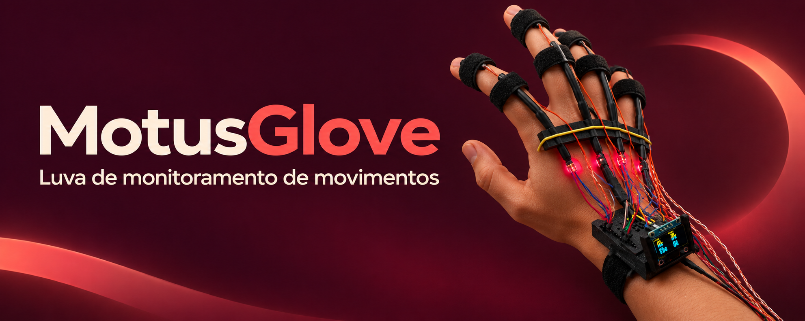
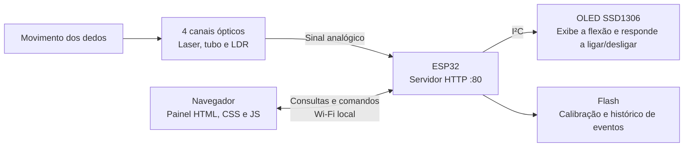
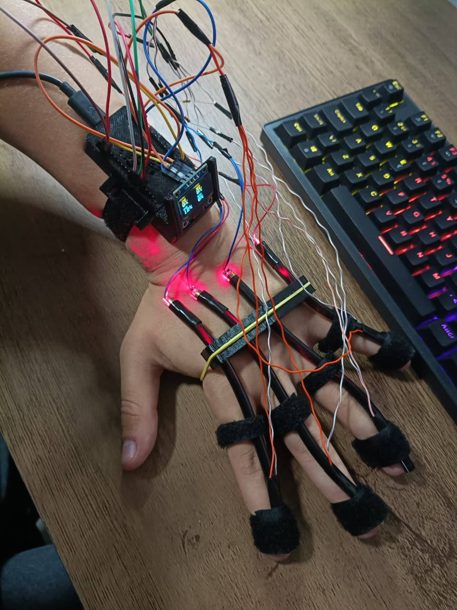

# MotusGlove

**Luva experimental que acompanha a flexão de quatro dedos com sensores ópticos e transmite as leituras para um painel web.**

Projeto de Conectividade em Sistemas Ciberfísicos · Engenharia de Software · PUCPR

[Lista de materiais](docs/materiais.md) · [Montagem e pinagem](docs/montagem.md) · [API HTTP](docs/api.md) · [Testes e demonstração](docs/testes.md) · [Modelos 3D](3D)

## O que a luva faz

A MotusGlove investiga o uso de um conjunto óptico construído pela equipe para acompanhar o movimento dos dedos. Em cada canal, um laser ilumina um LDR através de um tubo. Conforme o conjunto se deforma, a luz recebida varia e o ESP32 mede a mudança no sinal.

O painel mostra o sinal bruto e a flexão relativa de indicador, médio, anelar e mindinho. A calibração usa duas posições escolhidas pelo usuário, 0% com os dedos esticados e 100% com os dedos dobrados. A porcentagem expressa a posição dentro dessa faixa de referência. A medição de ângulo em graus e a precisão do sensor ainda precisam de validação.

## Arquitetura



O ESP32 hospeda o painel e responde às requisições do navegador. O cliente recebe as leituras, mostra o estado da conexão e envia comandos de calibração e de controle do OLED. O OLED é a saída física controlável pela rede.

## Hardware

| Componente | Quantidade | Função |
| --- | ---: | --- |
| ESP32 | 1 | Lê os canais, serve o painel e controla o OLED |
| Módulo laser, tubo, LDR e resistor | 4 conjuntos | Convertem a flexão de cada dedo em uma variação de sinal |
| OLED I²C SSD1306 | 1 | Exibe a flexão. A configuração do código é 128 × 64 e endereço `0x3C` |
| Luva, fios, cabo USB e suportes | Conforme a montagem | Integração física, alimentação e gravação |

A [lista de materiais](docs/materiais.md) detalha as peças por canal e separa as quantidades usadas dos lotes comprados.

Os quatro canais usam GPIO32, GPIO33, GPIO34 e GPIO35. Veja o [esquema elétrico completo](docs/imagens/circuito-motusglove.svg) e a [tabela de ligações](docs/montagem.md#ligações-do-firmware-de-quatro-canais). O OLED usa **SDA no GPIO21** e **SCL no GPIO22**.

## Como executar

1. Abra [MotusGlove.ino](firmware/MotusGlove/MotusGlove.ino) no Arduino IDE.
2. Instale o pacote de placas **esp32** e as bibliotecas **Adafruit GFX Library** e **Adafruit SSD1306**, com as dependências oferecidas pelo gerenciador. O registro de gravação do protótipo indica o pacote ESP32 **3.3.12**.
3. Na pasta do sketch, duplique `wifi_config.example.h` com o nome `wifi_config.h`. Preencha `WIFI_NOME` e `WIFI_SENHA` com a rede de teste. O Git ignora esse arquivo local.
4. Escolha a placa correspondente ao seu ESP32 e a porta USB. Compile e carregue o sketch.
5. Abra o Monitor Serial em **115200 baud** e copie o IP informado após a conexão. Em um dispositivo na mesma rede, abra `http://IP_DO_ESP32/`. O painel é servido pelo ESP32 e abre diretamente no navegador.
6. Vista a luva, estique os quatro dedos e clique em **Registrar 0%**. Dobre os dedos e clique em **Registrar 100%** em até dois minutos. Depois de salvar, mova um dedo por vez e acompanhe o cartão correspondente.
7. Use o botão de controle do OLED e confira se o estado exibido no painel acompanha a mudança física no display.

Se o navegador não abrir, confirme o IP atual no Monitor Serial e se a rede permite comunicação entre os dispositivos. Se o painel pedir uma nova calibração, revise os canais indicados e confira a variação da leitura bruta.

## Comunicação HTTP

| Método | Rota | Uso |
| --- | --- | --- |
| GET | `/` | Carrega o painel web |
| GET | `/dados` | Consulta leituras, IP, MAC e estado do OLED |
| POST | `/calibracao` | Captura as posições de referência e salva a calibração |
| POST | `/oled` | Liga ou desliga o display |
| GET | `/logs` | Consulta ou baixa o histórico de eventos |

Consulte o [contrato da API](docs/api.md) para ver os campos, exemplos e respostas de erro.

## Demonstração e evidências



*Protótipo de quatro dedos em operação.*

O vídeo mostra as leituras dos quatro dedos variando conforme a luva se movimenta, com o painel aberto no computador e no celular. O OLED físico aparece ligado no início da gravação.

- [Vídeo de demonstração (MP4, 50 s)](docs/videos/demonstracao-motusglove.mp4)
- [Teste do OLED comandado pelo painel (MP4, 6 s)](docs/videos/oled-motus.mp4)
- [Painel em operação, em um quadro do vídeo](docs/imagens/painel-em-operacao-quadro-do-video.png)
- [Fotos da montagem](docs/montagem.md#fotos-do-protótipo) e [resultados dos testes](docs/testes.md#resultados-do-protótipo-integrado)

### Arquivos para impressão

[STL do suporte dorsal](3D/Suporte_MotusGlove.stl) · [STL da caixa](3D/Caixa_MotusGlove.stl)

## Estrutura do repositório

```text
docs/                    Materiais, montagem, API, testes e imagens
firmware/MotusGlove/     Sketch e modelo de configuração do Wi-Fi
3D/                     Arquivos STL para impressão
```

O cliente HTML, CSS e JavaScript está incorporado no sketch, no bloco `PAGINA`, para que o ESP32 sirva a interface junto com a API.

[Estudos de identidade visual](docs/Pain%C3%A9is%20de%20Marca%20Motus%20Glove%20em%20Tons%20Quentes.png)

## Equipe

| Integrante | GitHub | Contribuição |
| --- | --- | --- |
| Diego Rhian Bochnia | @diegobochnia | Desenvolvimento do firmware e do painel web, montagem elétrica, integração dos sensores e do OLED, conectividade, testes e documentação |
| Pedro Chaves Steck | @Pyroo0 | Modelagem e impressão 3D e apresentação do projeto |
| Guilherme Mockzedlo Kadubitzki | @GuiKadz | Apresentação do projeto |
| Luigi Ulbrich Pietrobon | @Luup2177 | Apresentação do projeto |
| Vinicius Dias Marcondes da Cruz | @Vmarcondes-dev | Apresentação do projeto |
