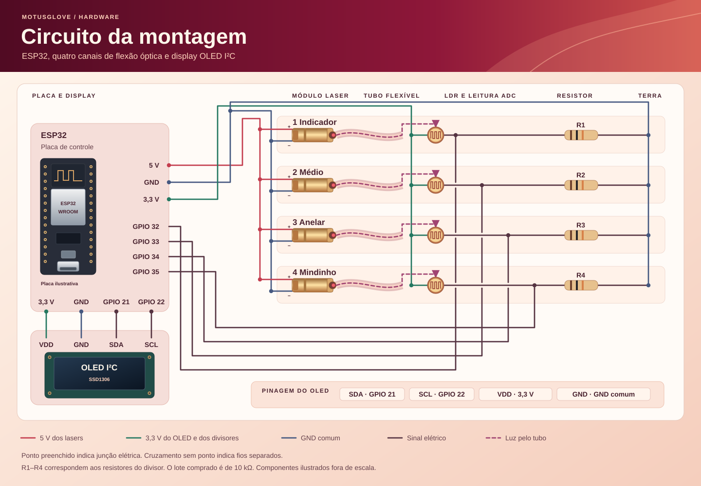
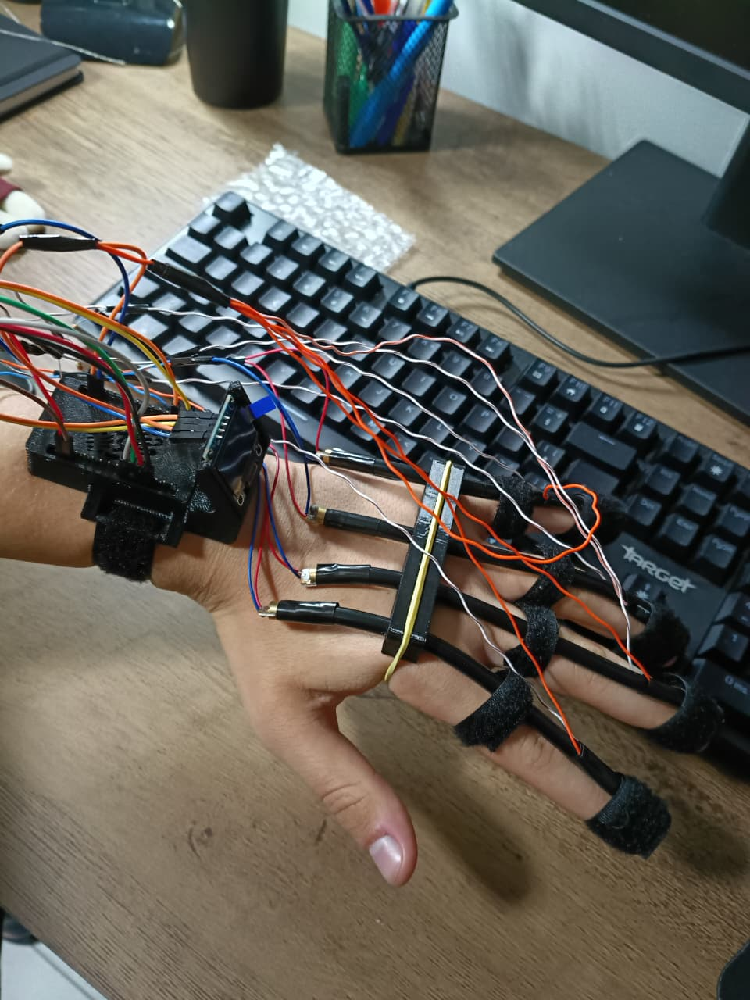
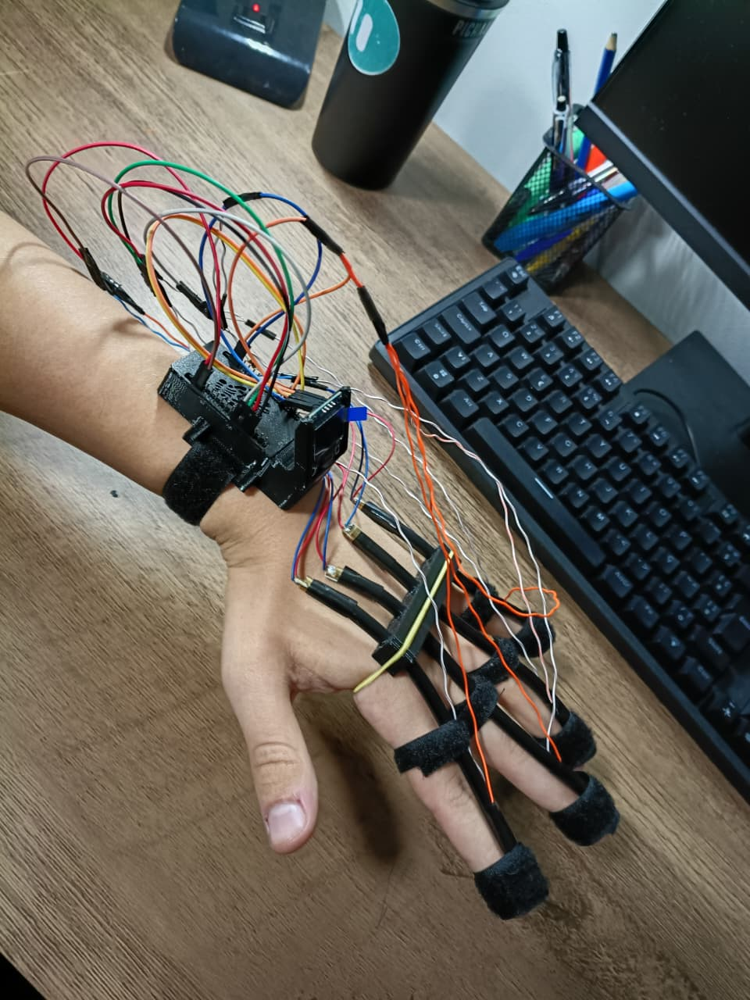

# Montagem e pinagem

[Voltar ao projeto](../README.md) · [Lista de materiais](materiais.md)

Cada canal combina um laser, um tubo e um LDR. O tubo forma o caminho entre o emissor e o sensor. O LDR e um resistor formam um divisor de tensão que o ESP32 lê em uma entrada analógica.

## Esquema elétrico de quatro canais

[Baixar o desenho da montagem em alta resolução (PNG)](imagens/circuito-motusglove-alta-resolucao.png)

Os quatro lasers compartilham a alimentação de **5 V** e o GND. Cada LDR forma um divisor entre **3,3 V** e GND, com uma entrada analógica própria. O OLED também recebe **3,3 V** no VDD, conforme o desenho de montagem.

O OLED usa **GPIO21 para SDA** e **GPIO22 para SCL**, conforme a montagem e a configuração `Wire.begin(21, 22)` no firmware.

O relatório registra resistores de **10 kΩ**. Confira o valor dos componentes instalados. Monte com a alimentação desligada e mantenha o feixe dentro do conjunto óptico.

## Ligações do firmware de quatro canais

| Componente ou sinal | Destino | Observação |
| --- | --- | --- |
| Nó do indicador | GPIO32 | Junção do LDR e do resistor do canal |
| Nó do médio | GPIO33 | Junção do LDR e do resistor do canal |
| Nó do anelar | GPIO34 | Junção do LDR e do resistor do canal |
| Nó do mindinho | GPIO35 | Junção do LDR e do resistor do canal |
| LDR de cada canal | 3,3 V e nó de leitura | Um terminal em cada ponto |
| Resistor de cada canal | Nó de leitura e GND | Um terminal em cada ponto |
| Positivo do módulo laser | 5 V | Alimentação comum aos quatro módulos |
| GND do módulo laser | GND comum | Confirme a pinagem no módulo |
| OLED SDA | GPIO21 | Dados do barramento I²C |
| OLED SCL | GPIO22 | Relógio do barramento I²C |
| OLED VDD | 3,3 V | Alimentação indicada no desenho de montagem |
| OLED GND | GND comum | Confira a ordem dos pinos no módulo |

O firmware usa um OLED SSD1306 de 128 × 64 pixels, no endereço I²C `0x3C`. A constante `OLED_ALTURA` permite configurar 32 linhas se o módulo utilizado for de 128 × 32. Nesse modo, o display alterna entre os dois pares de dedos.

## Integração física

1. Posicione o laser em uma extremidade do tubo e o LDR na outra.
2. Fixe o conjunto de modo que o tubo possa acompanhar a flexão. Deixe folga nos fios para que o movimento não force as conexões.
3. Identifique os canais e confira a correspondência entre dedo, entrada analógica e cartão no painel.
4. Teste a resposta bruta de cada canal, calibre a luva vestida e mova um dedo por vez para conferir a montagem.

O [suporte dorsal](../3D/Suporte_MotusGlove.stl) e a [caixa da eletrônica](../3D/Caixa_MotusGlove.stl) estão disponíveis em STL. Verifique o encaixe e o deslizamento dos tubos na montagem real.

## Fotos do protótipo

As fotos mostram a fixação dos tubos sobre os dedos, o suporte dorsal e a eletrônica no punho. Veja também a [foto com o OLED ligado](imagens/motusglove-em-operacao.png).

## Dados da montagem a registrar

- Modelo exato da placa, do laser, do LDR e do OLED.
- Valor e tolerância dos resistores, material e dimensões dos tubos.
- Alimentação e fixação usadas no conjunto final.
