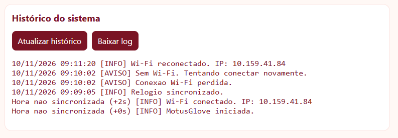
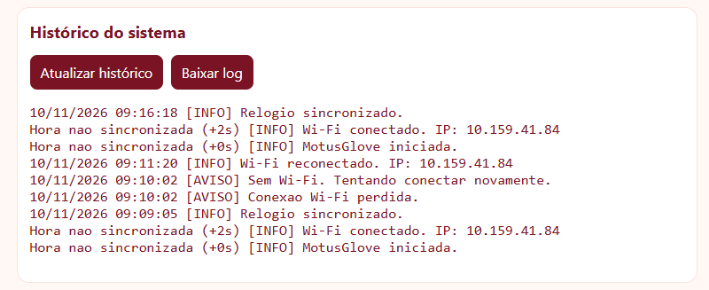
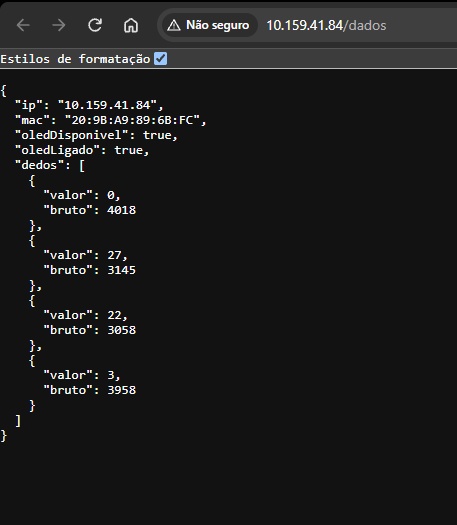
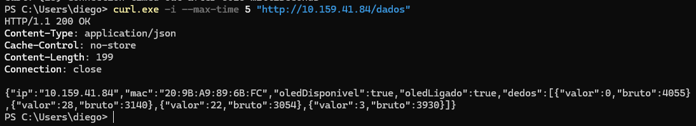
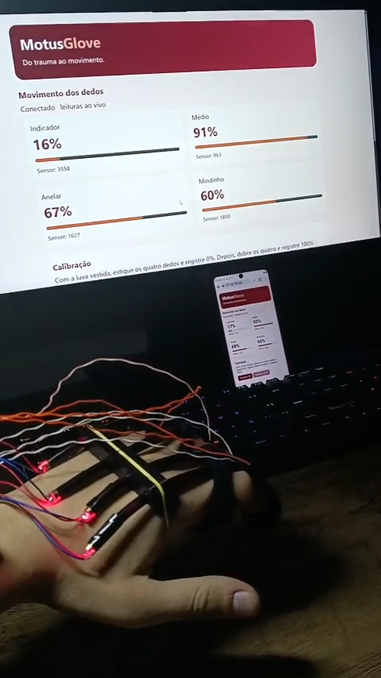

# Testes e demonstração

[Voltar ao projeto](../README.md)

## O que já foi observado

| Etapa | Resultado registrado | Evidência disponível |
| --- | --- | --- |
| Bancada de um canal | O ESP32 leu o sensor, o sinal variou com o movimento e o painel aceitou a calibração aberta e fechada. | Registro inicial da equipe, sem série numérica ou imagens anexadas. |
| Firmware de quatro canais | A equipe compilou e gravou o firmware no ESP32. | Registro de gravação com verificação dos dados gravados. |
| Acesso ao painel | A equipe relatou que o painel abriu após a gravação. | [Quadro do vídeo com a interface aberta](imagens/painel-em-operacao-quadro-do-video.png). |
| Conectividade IP | O ESP32 respondeu aos quatro pacotes de ping, sem perda. | Captura do teste registrada pela equipe. |
| Porta do servidor | O teste da porta TCP 80 retornou `TcpTestSucceeded: True`. | Captura do PowerShell registrada pela equipe. |
| Rota de histórico | O ESP32 retornou HTTP 503 em `/logs` por armazenamento indisponível na versão gravada naquele teste. | Saída do cURL registrada pela equipe. |
| Correção do armazenamento | O firmware que prepara a partição vazia foi compilado para a placa DOIT ESP32 DEVKIT V1. | Compilação concluída. O histórico voltou a aparecer no painel em 10/11/2026. A persistência após reinício foi confirmada no T04. |

Os resultados de bancada de um canal pertencem à etapa anterior. As verificações abaixo correspondem ao protótipo integrado de quatro canais.

## Validação do protótipo integrado

| ID | Procedimento | Resultado esperado e evidência |
| --- | --- | --- |
| T01 | Abra o painel em outro dispositivo na mesma rede. Faça `GET /dados`. | O painel indica conexão e a API devolve quatro canais, IP, MAC e estado do OLED. Salve a captura e a resposta HTTP. |
| T02 | Calibre com a luva vestida e mova cada dedo separadamente. Faça cinco ciclos de estender e dobrar. | O cartão do dedo correspondente responde. Registre leitura bruta e percentual por canal, posição e repetição. |
| T03 | Desligue e ligue o OLED pelo painel. Repita com `POST /oled` e envie um estado inválido. | O display reage fisicamente, o painel acompanha o estado e a API devolve `400` para estado inválido. Grave o display junto do painel. |
| T04 | Reinicie o ESP32 após uma calibração válida e volte ao painel. | Os quatro canais usam a calibração salva e os logs anteriores continuam acessíveis se o LittleFS estiver montado. Registre o antes e o depois. |
| T05 | Interrompa e restabeleça o Wi-Fi usado pelo ESP32. Confira o IP após reconectar. | O painel sinaliza a falha enquanto está inacessível. Após a reconexão, as leituras voltam no endereço atual. Registre o tempo de recuperação e os eventos no log. |
| T06 | Mantenha duas abas consultando o painel por cinco minutos. Durante a consulta, mova os dedos e alterne o OLED. | As leituras e os comandos continuam disponíveis. Registre atrasos, erros e eventuais reinicializações. |
| T07 | Repita a segunda etapa da calibração com sessão expirada e, em uma nova sessão, sem mover um canal. | A API devolve `409` para a sessão expirada e `422` para variação insuficiente. Confira que a calibração anterior segue ativa. |
| T08 | Consulte o histórico com e sem sincronização NTP, usando o Monitor Serial como referência. | O log registra o tempo desde a inicialização até a sincronização e passa a usar data e hora depois. Salve um trecho de cada condição. |

Preencha cada resultado após executar o procedimento. Inclua data, responsável, revisão do firmware, placa, alimentação, condições de teste, resultado observado e link para a evidência. Para comparar repetibilidade, mantenha a fixação e a iluminação e use a mesma calibração em todos os ciclos.

### Reconexão Wi-Fi e horário do histórico

Em 10/11/2026, o painel registrou a sincronização do relógio às **09h09min05s**, a perda da conexão às **09h10min02s** e a reconexão às **09h11min20s**. O aviso de tentativa de reconexão também aparece no histórico. Antes da sincronização, o firmware registrou os eventos com o tempo decorrido desde a inicialização. O intervalo entre perda e reconexão foi de **1 min 18 s**. Ele inclui o período em que a rede ficou indisponível.

A captura comprova o registro dos eventos de rede e a transição para data e hora após a sincronização (T05 e T08).



### Persistência do histórico após reiniciar

Após reiniciar o ESP32 em 10/11/2026, o painel mostrou uma nova entrada de inicialização, a conexão ao Wi-Fi e a sincronização do relógio às **09h16min18s**. O histórico também manteve a perda de conexão das **09h10min02s** e a reconexão das **09h11min20s** registradas antes do reinício. O teste confirma a persistência dos logs na flash (T04). A retenção da calibração é uma verificação separada.



### Consulta dos sensores pela API

Em 10/11/2026, a rota `GET /dados` foi aberta no navegador e retornou um JSON com o IP e o MAC do ESP32, o estado do OLED e quatro canais de leitura, na ordem documentada na [API](api.md). O OLED estava disponível e ligado.

| Dedo | Flexão relativa | Leitura bruta (ADC) |
| --- | ---: | ---: |
| Indicador | 0% | 4018 |
| Médio | 27% | 3145 |
| Anelar | 22% | 3058 |
| Mindinho | 3% | 3958 |

A captura do navegador comprova o conteúdo da resposta (T01). Em uma segunda consulta, o cURL exibiu `HTTP/1.1 200 OK` e `Content-Type: application/json`, com quatro canais no corpo da resposta. Os valores dessa segunda leitura variaram em relação aos da tabela, que registra a consulta feita pelo navegador.





## Resultados do protótipo integrado

O [vídeo de demonstração](videos/demonstracao-motusglove.mp4) mostra a montagem alimentada, o OLED exibindo dados e o painel aberto no celular e no computador. Durante a flexão, os percentuais dos quatro canais variam no painel. O vídeo registra o funcionamento em uma sessão, sem medir precisão ou repetibilidade.



### Acionamento do OLED pela rede

No [vídeo do teste do atuador](videos/oled-motus.mp4), o OLED físico aparece ligado, apaga após o comando no painel e volta a acender após o comando de ligar. A gravação reúne o painel e o display físico e comprova o acionamento pela rede (T03). O teste de resposta a um estado inválido continua separado.

## Verificação da rede no Windows

Substitua o endereço de exemplo pelo IP atual do ESP32. Execute os comandos de um computador na mesma rede e salve as saídas com a data do teste e a versão do firmware.

```powershell
$esp = '192.168.1.50'
ping $esp
Test-NetConnection -ComputerName $esp -Port 80
curl.exe -i --max-time 5 "http://$esp/dados"
curl.exe -i --max-time 5 "http://$esp/logs"
```

Em `/dados`, registre o HTTP 200 e a resposta com os quatro canais. Em `/logs`, registre os eventos gerados ao ligar e desligar o OLED. Depois, confira a perda e a reconexão ao Wi-Fi com o ESP32 ligado e verifique se os eventos continuam disponíveis após reiniciar a placa.

## Roteiro para o vídeo

1. Mostre a luva, o ESP32 e o OLED montados. Identifique os canais ópticos.
2. Abra o painel pelo IP do ESP32 e mostre o indicador de conexão.
3. Registre 0% e 100%. Mova um dedo por vez para mostrar a resposta no painel e no OLED.
4. Desligue e ligue o OLED pelo navegador, com o display aparecendo na gravação.
5. Mostre o histórico com os eventos gerados durante a demonstração.

As fotos e o quadro do painel estão em `docs/imagens/`. Para novos testes, identifique na evidência a montagem e a versão do firmware demonstradas.
